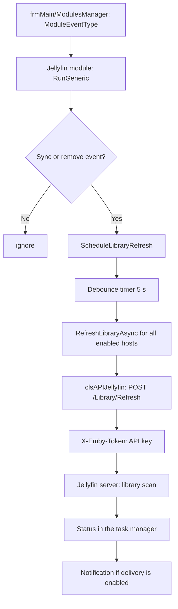

← [Back to overview](index.md)

# Jellyfin Interface — Technical Flow

## Overview

The module `generic.Interface.Jellyfin` (`Addons/generic.Interface.Jellyfin/Interface.Jellyfin.vb`) implements `Interfaces.GenericModule`. It subscribes to the events `Sync_Movie`, `Sync_MovieSet`, `Sync_TVEpisode`, `Sync_TVSeason`, `Sync_TVShow`, `Remove_Movie`, `Remove_TVEpisode` and `Remove_TVShow`. The API calls are encapsulated by `clsAPIJellyfin` (`Addons/generic.Interface.Jellyfin/clsAPIJellyfin.vb`).

Jellyfin cannot update single items. Every event therefore only schedules a debounced library refresh — the Jellyfin servers are never maintained item by item.

## Flow

### 1. Initialisation

`Init` loads the module settings from `Interface.Jellyfin.xml` in the profile folder. The settings hold the list of hosts (`Name`, `Url`, `ApiKey`, `Enabled`) and the notification option. The URLs are normalised via `NormalizeBaseUrl` when they are loaded and when they are saved.

### 2. Event handling

`RunGeneric` receives the events of the module system. For the events listed above `ScheduleLibraryRefresh` is called, every other event is ignored (`breakChain = False`).

### 3. Debouncing

`ScheduleLibraryRefresh` re-arms a `System.Threading.Timer` (delay of 5 seconds, no repetition). Every further event restarts the delay, so a bulk import triggers only one scan. A `System.Windows.Forms.Timer` cannot be used here because the module is instantiated by a background worker.

### 4. Refresh

The timer callback `OnLibraryRefreshTimer` starts `RefreshLibraryAsync` for every enabled host. Per host `POST {base URL}/Library/Refresh` is executed with the API key as `X-Emby-Token`. While it runs, the task manager in the status bar shows the status *Update Jellyfin Library*. Errors per host are logged and — if notifications are enabled — reported as an error notification.

### 5. Menus and settings

When the module is enabled the menu entries *Jellyfin* are created in the Tools menu (`mnuMainTools`) and in the tray menu (`cmnuTrayTools`). Depending on the number of enabled hosts the submenu contains the entries *Update Library* and *Check Connection* directly, or one submenu entry per host. The host dialog (`dlgHost`) allows creating and editing a host including *Check Connection*.

## Diagram

## Error handling

- Unreachable hosts, timeouts (15 seconds per call) and HTTP errors are caught and logged; the Ember library stays untouched.
- An invalid base URL is already rejected when the host is saved.
- Errors of the debounce timer are logged; the timer stays ready for further events.
